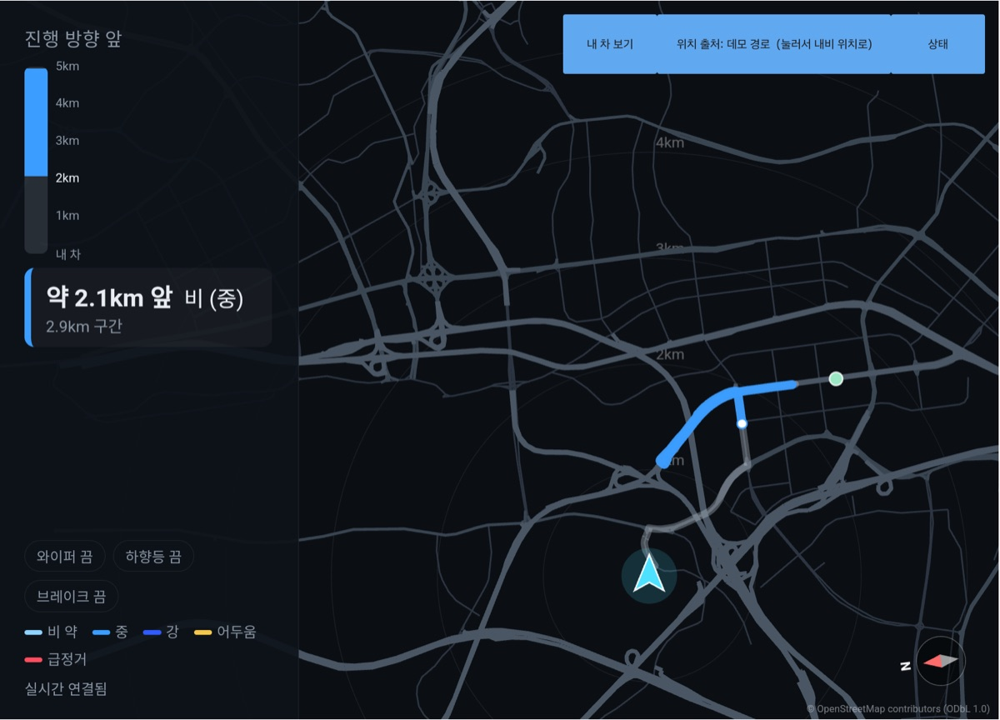
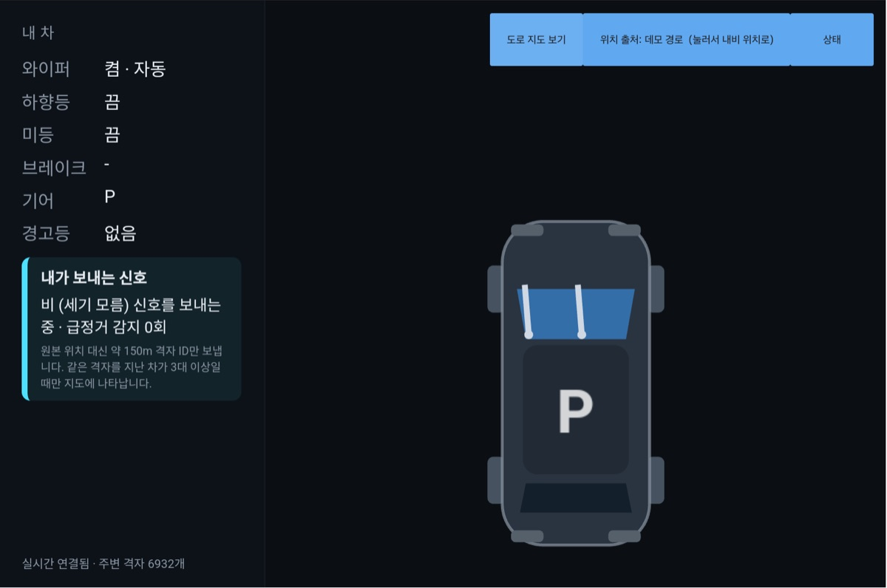
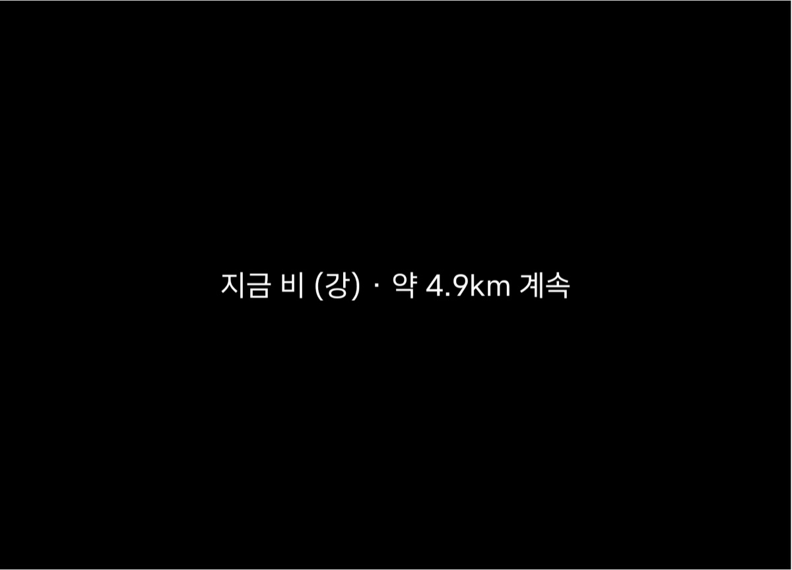

# Road Sensor (가칭)

앞서 간 차들의 와이퍼·라이트·브레이크 신호를 익명으로 모아, 내가 가는 방향 앞의 비·어두움·급정거 구간을 미리 알려 주는 Pleos Connect 차량용 앱입니다.

| 도로 지도 (정차) | 내 차 | 주행 모드 |
| --- | --- | --- |
|  |  |  |

화면은 Pleos Connect Emulator 2.1.0에서 찍었습니다. 지도의 비 구간과 내 차 화면의 신호는 시뮬레이터와 Virtual Console로 만든 값입니다.

## 무엇을 하나

- **차량 신호 수집**: Pleos Vehicle SDK로 와이퍼(켜짐·스위치 단계), 하향등·미등, 브레이크 페달을 구독하고, AAOS Car API로 속도·기어·주행 규제를 읽습니다. 수집은 포그라운드 서비스에서 합니다.
- **익명 공유**: 정확한 좌표 대신 약 150m 격자(geohash 7자리) ID, 분 단위 시각, 30분마다 바뀌는 임시 ID만 서버로 보냅니다. 서버는 서로 다른 차 3대 이상이 모인 격자만 배포합니다.
- **도로 지도(정차 중)**: 배경 도로 위에 내가 갈 앞길 5km를 상태별로 색칠합니다(비 파랑, 어두움 노랑, 급정거 빨강). 왼쪽 패널의 "앞 5km 막대"가 같은 구간을 한 줄로 보여 줍니다. WebView + WebGL2(PixiJS)로 그리고, 바뀐 것이 없으면 렌더링을 멈춥니다.
- **진행 방향 앞 알림**: 앞길 위 구간을 "약 2.1km 앞 비 (중) · 2.9km 구간"처럼 알립니다. 거리는 길을 따라 잰 값입니다(내비 위치처럼 길을 모르면 진행 방향 직선 기준).
- **주행 모드**: `CarUxRestrictions`가 주행을 알리면 지도를 숨기고 큰 글자 한 줄만 보여 줍니다(네이티브 화면).
- **내 차 화면**: 차량 모형에 와이퍼·라이트·브레이크·기어·경고등 상태와 내가 보내는 신호.

## 저장소 구성

| 폴더 | 내용 |
| --- | --- |
| `android/` | 차량 앱. `:core`(순수 Kotlin: 판정·상태 스토어·렌더 모델, 단위 테스트) + `:app`(포그라운드 서비스, Pleos·AAOS 어댑터, 업로더, 화면) |
| `shared/` | 지도 그리기 코드(TypeScript + PixiJS). 차량 앱 WebView용으로 번들해 `android/app/src/main/assets/web/`에 넣는다 |
| `server/` | 집계 서버(Node.js + TypeScript, Fastify). 업로드 `POST /v1/observations`, 구독 `WS /v1/stream` |
| `simulator/` | 데모용 가상 차(비 구간 재생, 기상청 강수 기반) |
| `docs/` | 설계(`architecture.md`), 진행 기록(`progress.md`), Pleos SDK 정리(`pleos/`) |

## 테스트 환경

- Pleos Connect Emulator 2.1.0 (Android 14, API 34, arm64), AVD 설정: RAM 4GB, Cold boot
- Android Studio 2026.2.1(JDK 17은 내장 JBR), Android Gradle Plugin 9.4.0, Gradle 9.6.1
- Node.js 24 이상(서버·시뮬레이터·지도 번들)
- macOS(Apple Silicon)에서 확인했습니다.

## 실행 방법

에뮬레이터에서 앱은 AAOS 사용자 10으로 실행됩니다. 서버는 개발 PC에서 돌리고, 에뮬레이터는 `adb reverse`로 붙습니다.

1. 서버 실행

   ```bash
   cd server && npm install && npm start
   ```

2. 에뮬레이터를 켠 뒤 서버 포트를 연결

   ```bash
   adb reverse tcp:8080 tcp:8080
   ```

3. 앱 설치와 실행

   ```bash
   adb install -r apk/<release APK 파일>
   adb shell am start --user 10 -n io.roadsensor/.ui.MainActivity
   ```

   처음 실행하면 속도 권한을 묻습니다(정차 중). 미리 주려면:

   ```bash
   adb shell pm grant --user 10 io.roadsensor android.car.permission.CAR_SPEED
   ```

4. 가상 차 실행(데모 경로를 출발하면 어두운 구간 → 급정거 잦은 곳 → 비 구간 순서로 나타납니다)

   ```bash
   cd simulator && npm run zones
   ```

   비 구간만 보려면 `npm run rain`입니다. 기상청 강수 분포를 쓰는 가상 차 수천 대는 `npm run kma -- --snapshot <파일>`입니다([docs/kma-rain.md](docs/kma-rain.md)).

5. Virtual Console(`adb forward tcp:8088 tcp:8088` → `http://127.0.0.1:8088/`)에서 기어를 D로 바꾸고 ACCEL을 누르면 주행 모드 한 줄 알림으로 바뀌고, 데모 경로를 따라 차가 움직입니다. 와이퍼·하향등·브레이크도 여기서 조작합니다.

- 에뮬레이터의 내비 위치는 고정이라(시흥동), 앱은 기본으로 **데모 경로 재생**을 위치 출처로 씁니다. 정차 화면 오른쪽 위의 [도로 지도 | 내 차] 탭을 **길게 누르면** 시연용 버튼(위치 출처, 상태)이 나타나고, 여기서 내비 위치로 바꿀 수 있습니다.
- 데모 경로는 시흥동 → 판교역 실제 도로(약 5.4km)입니다.

## 빌드

```bash
# 지도 번들(shared/를 고쳤을 때)
cd shared && npm install && npm run build:car

# 앱
cd android
./gradlew :core:test          # 판정·스토어 단위 테스트
./gradlew :app:assembleDebug
./gradlew :app:assembleRelease  # R8 코드 축소. 서명 키는 아래
```

- release 서명 키는 저장소 밖의 `~/.android-keys/road-sensor/keystore.properties`(`storeFile`, `storePassword`, `keyAlias`, `keyPassword`)에서 읽습니다. 다른 위치는 `-ProadSensor.keystore=<경로>`.
- 테스트: `server/`·`simulator/`·`shared/`에서 `npm test`.

## APK 위치

`apk/` 폴더 `[제출 전 추가]`

## 개인정보

- 서버로 보내는 것: 격자 ID(약 150m), 분 단위 시각, 관측값(와이퍼 강도, 하향등 켬/끔, 급정거 방향), 30분마다 바뀌는 임시 ID
- 보내지 않는 것: 정확한 좌표, 경로, 출발지·목적지, 차량번호, 차대번호, 계정, 고정 기기 ID
- 서버는 서로 다른 임시 ID 3개 이상이 모인 격자만 배포하고, 로그에는 메서드·경로·상태만 남깁니다.

## 오픈소스와 데이터 출처

| 이름 | 쓰는 곳 | 라이선스 |
| --- | --- | --- |
| [OkHttp](https://square.github.io/okhttp/) 4.12.0 | 앱: 지도 구독 WebSocket | Apache License 2.0 |
| [kotlinx.coroutines](https://github.com/Kotlin/kotlinx.coroutines) 1.10.2 | 앱 | Apache License 2.0 |
| [PixiJS](https://pixijs.com/) 8.22.0 | 지도 그리기(앱 번들에 포함) | MIT |
| PixiJS 의존 라이브러리: @pixi/colord, earcut, eventemitter3, gifuct-js, ismobilejs, parse-svg-path, @xmldom/xmldom, tiny-lru | 앱 번들에 포함될 수 있음 | MIT, ISC(earcut), BSD-3-Clause(tiny-lru) |
| [Fastify](https://fastify.dev/) 5.12.7, [@fastify/websocket](https://github.com/fastify/fastify-websocket) 11.3.4 | 서버 | MIT |
| [esbuild](https://esbuild.github.io/) 0.28.2 | 지도 번들 빌드 도구 | MIT |
| Pleos Vehicle SDK 2.3.2, NaviHelper SDK 3.0.5 | 앱 | Pleos Playground 제공 |
| [OpenStreetMap](https://www.openstreetmap.org/copyright) | 데모 경로(`assets/tracks/sihung-pangyo-road.json`, 경로 계산은 [OSRM](https://project-osrm.org/)), 지도 배경 도로(`shared/data/roads-demo.json`, [Overpass API](https://overpass-api.de/)로 추출) | © OpenStreetMap contributors, ODbL 1.0 |
| 기상청 단기예보 조회서비스(공공데이터포털) | 시뮬레이터 강수 자료 | 공공데이터포털 이용 조건 |
| [Asta Sans](https://github.com/42dot/Asta-Sans) (42dot) | 화면 글꼴. 앱에 넣지 않고 차량(Pleos Connect)에 설치된 기본 글꼴을 그대로 쓴다 | SIL Open Font License 1.1 |
